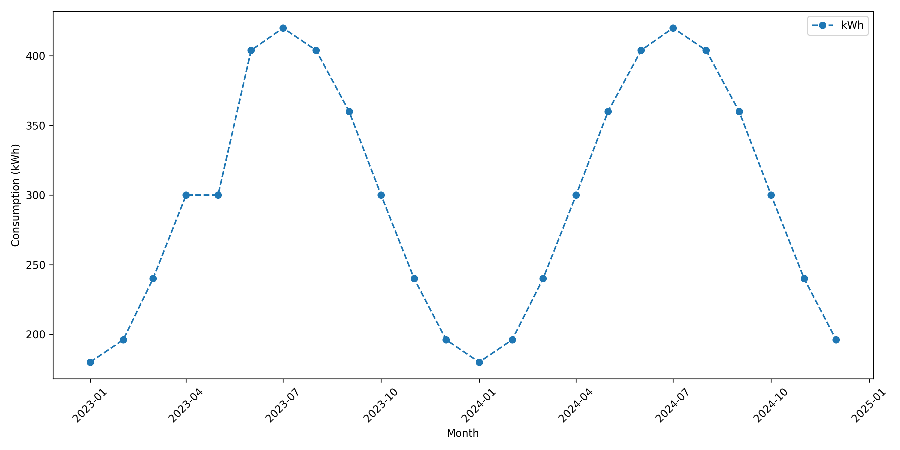

# ⚡ Monthly Electricity Consumption Trend Analysis Using Python

## 📌 Project Overview

This project analyzes monthly electricity consumption trends using Python and data visualization techniques. It uses a line graph to visualize electricity consumption over a period of 24 months.

## 🎯 Objectives

- Analyze monthly electricity consumption.
- Identify seasonal consumption patterns.
- Visualize electricity usage over time.
- Understand data handling and visualization using Python.

## 🛠️ Technologies Used

- Python
- NumPy
- Pandas
- Matplotlib
- Google Colab

## 📂 Project Structure

```text
Electricity-Consumption-Analysis/
│
├── Electricity_Consumption_Analysis.ipynb
├── electricity.csv
├── electricity_consumption_trend.png
└── README.md
```

## 📊 Dataset Information

The dataset is stored in `electricity.csv`.

| Column | Description |
|---|---|
| Date | Monthly observation date |
| kWh | Electricity consumption |
| Bill | Estimated electricity bill |

The dataset contains 24 monthly records from January 2023 to December 2024.

**Note:** The dataset contains synthetic sample data for educational and visualization purposes.

## ⚙️ Installation and Execution

**Step 1:** Clone the repository.

```bash
git clone https://github.com/karanbagade236-sketch/Electricity-Consumption-Analysis.git
```

**Step 2:** Navigate to the project folder.

```bash
cd Electricity-Consumption-Analysis
```

**Step 3:** Install the required libraries.

```bash
pip install numpy pandas matplotlib
```

**Step 4:** Open the notebook using Jupyter Notebook or Google Colab.

**Step 5:** Upload `electricity.csv` and run the notebook cells.

## 📈 Project Output

### Monthly Electricity Consumption Trend



The graph represents monthly electricity consumption in kWh from January 2023 to December 2024.

## 💡 Key Learning Outcomes

- Reading CSV files using Pandas.
- Handling missing values.
- Calculating median values.
- Creating line graphs using Matplotlib.
- Saving visualizations as PNG images.

## 👨‍💻 Author

**Karan N B**

Computer Science and Engineering Student

## 📜 License

This project is intended for educational and learning purposes.
